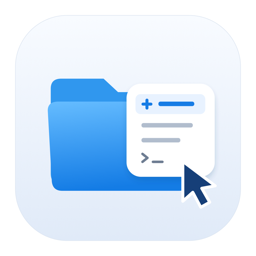

<p align="center">
  
</p>

<h1 align="center">Finder2right</h1>

<p align="center">在 Finder 中新建文件、打开终端、运行常用命令。</p>
<p align="center">macOS 14+ · Apple Silicon · SwiftUI · <a href="LICENSE">MIT License</a></p>

<p align="center">
  
</p>

## 功能

- **新建文件**：通过 Finder 右键菜单或工具栏创建 TXT、Markdown 等空白文件，支持预设与自定义扩展名。
- **打开目录终端**：在当前 Finder 文件夹中打开 macOS Terminal。
- **常用命令**：保存并运行多行终端命令，自动切换到当前目录。
- **原生设置**：管理启用状态和菜单顺序，支持菜单预览及系统浅色、深色外观。

<details>
<summary>查看终端命令设置</summary>


</details>

## 安装与使用

从 [GitHub Releases](https://github.com/fanglinwei/Finder2right/releases/latest) 下载最新安装包，或直接下载 [Finder2right 0.1.0（Apple Silicon）](https://github.com/fanglinwei/Finder2right/releases/download/v0.1.0/Finder2right-0.1.0-arm64.dmg)。需要 macOS 14 或更高版本，当前安装包不支持 Intel Mac。

1. 双击打开 `Finder2right-0.1.0-arm64.dmg`，将 **Finder2right** 拖入右侧的 **Applications（应用程序）**。替换旧版本前先退出 App。
2. 从「应用程序」文件夹打开 Finder2right。安装包使用 ad-hoc 签名，未经 Apple 公证；若首次打开被拦截，按 DMG 内的「安装指南」单独放行此 App。DMG 也附有仅处理 Finder2right 下载隔离属性的辅助脚本。
3. 点击 App 中的 **Finder 扩展设置…**，启用 **FinderExtension**。若系统未发现扩展，确认 App 已安装到「应用程序」并打开过一次，避免保留多个相同标识的副本。
4. 在 Finder 文件夹内空白处或单个文件夹上点右键，选择 **新建文件**。如需终端入口，在 Finder 工具栏上点右键 → **自定工具栏…**，将 **新建文件** 按钮拖入工具栏，通过它打开当前目录终端或运行已保存的命令。
5. 安装完成后弹出 DMG；请勿直接从安装磁盘运行 App。

详细步骤见 DMG 内的离线 HTML 安装指南；[指南来源](Releases/安装指南.html)也随源码提供。

文件类型与命令在应用中配置，保存后下次展开菜单即可生效。新建文件通过系统保存窗口命名，不覆盖已有文件；所有文件类型均创建空文件，不包含格式模板。

首次使用终端功能时，按系统提示允许 Finder2right 控制 Terminal；可在「系统设置 → 隐私与安全性 → 自动化」中管理权限。命令以当前用户权限直接执行，请仅添加可信内容。

## 本地构建

需要 macOS 14+ 和完整 Xcode（含命令行工具）。

```sh
git clone https://github.com/fanglinwei/Finder2right.git
cd Finder2right
./script/test.sh
./script/build_and_run.sh --build
```

构建产物位于 `build/Build/Products/Debug/Finder2right.app`。Xcode 不在默认路径时，可通过 `FINDER2RIGHT_DEVELOPER_DIR` 指定其 `Contents/Developer` 目录。
也可用 Xcode 打开 `Finder2right.xcodeproj`，选择 **Finder2right → My Mac**，按 **⌘R** 构建运行。

## 本地打包

```sh
./Releases/package-dmg.sh
```

脚本构建 Release（仅 arm64），生成 DMG 和离线 HTML 安装指南，并检查 Finder 扩展、签名、架构与镜像布局。首次运行需要联网安装两个固定版本的 Python 布局依赖。详细环境、跳过构建及校验方法见 [打包说明](Releases/packaging/README.md)。本流程不上传或发布安装包。

## 当前限制

- 当前使用 ad-hoc 开发签名及扩展只读 sandbox 临时例外；正式分发前需配置开发者签名、公证，并将共享配置迁移至 App Groups。
- Finder Sync 的菜单位置由系统决定；云盘、外接磁盘等目录尚需单独验证。

## 许可证

[MIT](LICENSE) © 2026 fanglinwei
