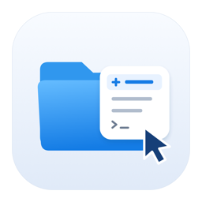
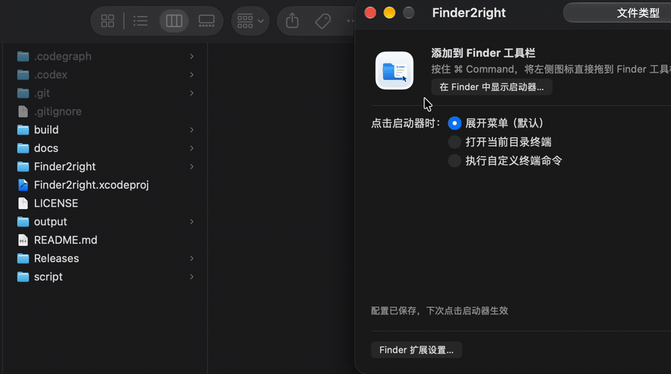
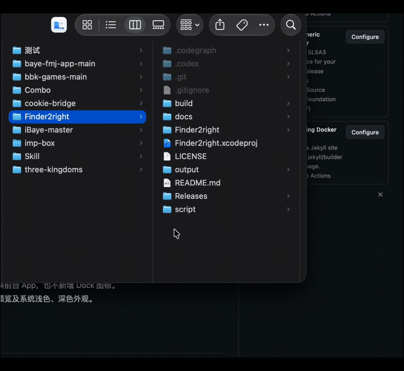
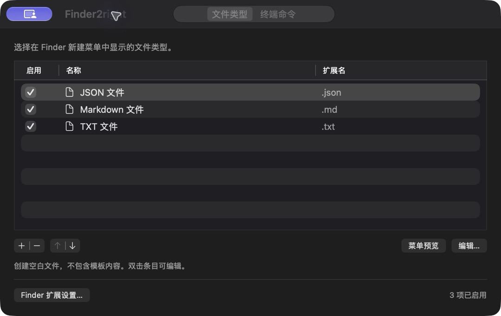
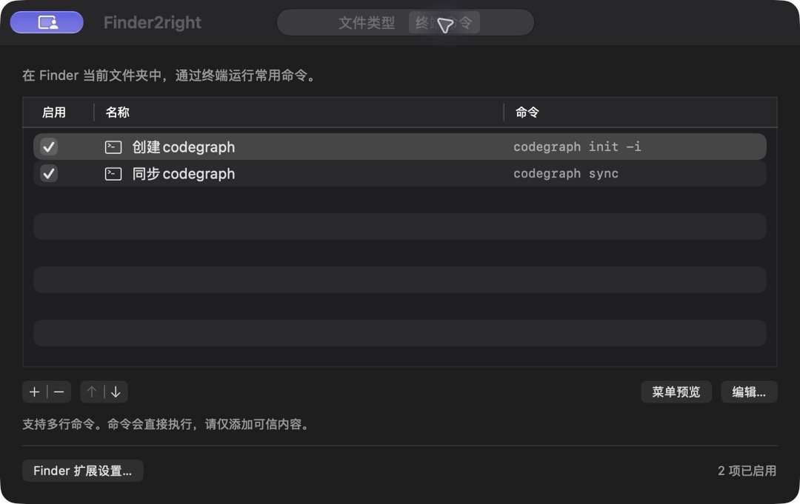
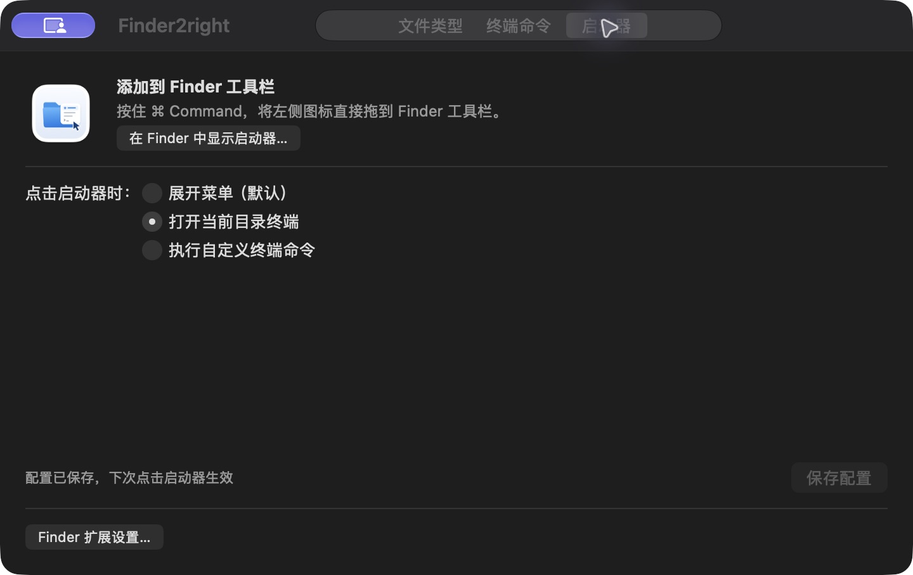

<p align="center">
  
</p>

<h1 align="center">Finder2right</h1>

<p align="center">在 Finder 中新建文件、打开终端、运行常用命令。</p>
<p align="center">macOS 14+ · Apple Silicon · SwiftUI · <a href="LICENSE">MIT License</a></p>

## 添加工具栏演示

将启动器添加到 Finder 工具栏，并通过工具栏使用 Finder2right：



## 右键菜单演示

在 Finder 中右键打开菜单，使用「新建文件」入口：




## 功能

- **新建文件**：通过 Finder 右键菜单或工具栏创建 TXT、Markdown 等空白文件，支持预设与自定义扩展名。
- **打开目录终端**：在当前 Finder 文件夹中打开 macOS Terminal。
- **常用命令**：保存多行终端命令，从菜单运行前预览完整命令与执行目录，确认后自动切换到当前目录执行。
- **工具栏启动器**：按住 ⌘ 将「启动器」配置页的图标拖入 Finder 工具栏；可选择展开菜单、打开当前目录终端或执行自定义多行命令。
- **后台菜单**：启动器可在鼠标位置展开菜单，不切换前台 App，也不新增 Dock 图标。
- **原生设置**：管理启用状态和菜单顺序，支持菜单预览及系统浅色、深色外观。

<details>
<summary>查看新建文件, 终端命令与工具栏启动器设置</summary>
<p align="center">
  
</p>





</details>

## 0.3.0 更新

- 从菜单运行已保存的终端命令前，先展示命令名称、完整命令和执行目录，确认后执行，支持取消。
- 长命令和长路径支持滚动查看，预览内容可选择复制；Return 确认，Escape 取消。
- 命令确认界面独立维护，补充布局、字体、确认与取消行为的回归测试。
- 新增 [架构说明](docs/architecture.md)，梳理进程、Module 与调用关系。

## 安装与使用

从 [GitHub Releases](https://github.com/fanglinwei/Finder2right/releases/latest) 下载最新安装包，或直接下载 [Finder2right 0.3.0（Apple Silicon）](https://github.com/fanglinwei/Finder2right/releases/download/v0.3.0/Finder2right-0.3.0-arm64.dmg)。需要 macOS 14 或更高版本，当前安装包不支持 Intel Mac。

1. 双击打开 `Finder2right-0.3.0-arm64.dmg`，将 **Finder2right** 拖入右侧的 **Applications（应用程序）**。替换旧版本前先退出 App。
2. 从「应用程序」文件夹打开 Finder2right。安装包使用 ad-hoc 签名，未经 Apple 公证；若首次打开被拦截，按 DMG 内的「安装指南」单独放行此 App。DMG 也附有仅处理 Finder2right 下载隔离属性的辅助脚本。
3. 点击 App 中的 **Finder 扩展设置…**，启用 **FinderExtension**。若系统未发现扩展，确认 App 已安装到「应用程序」并打开过一次，避免保留多个相同标识的副本。
4. 在 Finder 文件夹内空白处或单个文件夹上点右键，选择 **新建文件**。如需终端入口，在 Finder 工具栏上点右键 → **自定工具栏…**，将 **新建文件** 按钮拖入工具栏，通过它打开当前目录终端或运行已保存的命令。
5. 安装完成后弹出 DMG；请勿直接从安装磁盘运行 App。

详细步骤见 DMG 内的离线 HTML 安装指南；[指南来源](Releases/安装指南.html)也随源码提供。

文件类型与命令在应用中配置，保存后下次展开菜单即可生效。新建文件通过系统保存窗口命名，不覆盖已有文件；所有文件类型均创建空文件，不包含格式模板。

首次使用终端功能时，按系统提示允许 Finder2right 控制 Terminal；可在「系统设置 → 隐私与安全性 → 自动化」中管理权限。从菜单运行已保存的命令时，会先显示确认弹窗；启动器的「执行自定义终端命令」点击行为仍直接执行。命令以当前用户权限执行，请仅添加可信内容。

## 两种 Finder 入口

Finder 扩展和工具栏启动器可以同时使用，共用文件类型与命令配置。

- **Finder 扩展**：通过「Finder 扩展设置…」启用，提供右键菜单，以及带系统下拉箭头的工具栏按钮。
- **工具栏启动器**：打开主窗口的「启动器」配置页，按住 ⌘ 将页面中的图标直接拖到 Finder 工具栏，显示无下拉箭头的 App 图标。也可点击「在 Finder 中显示启动器…」后拖入。

构建后的主 App 内包含 `Contents/Helpers/Finder2right Launcher.app`，使用与主 App 相同的图标。在 Finder 中右键主 App →「显示包内容」，进入 `Contents/Helpers`，按住 **⌘ Command** 将该启动器拖到 Finder 工具栏。请保留启动器在 App 内的位置。

在「启动器」配置页选择点击行为，点击「保存配置」后，下次点击启动器生效：

1. **展开菜单（默认）**：在鼠标位置展开新建文件、打开目录终端和自定义命令菜单，与原有行为一致。不激活主 App，也不新增 Dock 图标；取消菜单后保留原窗口。
2. **打开当前目录终端**：直接在 Finder 当前文件夹打开 macOS Terminal。
3. **执行自定义终端命令**：在配置页填写命令，支持多行；点击启动器时自动切换到 Finder 当前文件夹并在 Terminal 中执行。

直接打开主 App 仍显示配置窗口和正常 Dock 图标。启动器读取 Finder 最前方窗口的本地文件夹，没有 Finder 窗口时使用桌面。首次使用需允许 Finder2right 控制 Finder；虚拟目录（如最近使用）会提示切换到本地文件夹。启动器点击行为仅影响 App 启动器，Finder 扩展菜单保持原有功能。

旧的 Finder Sync 工具栏按钮可按住 ⌘ 拖出工具栏；右键菜单扩展仍可使用。

## 本地构建

需要 macOS 14+ 和完整 Xcode（含命令行工具）。

```sh
git clone https://github.com/fanglinwei/Finder2right.git
cd Finder2right
./script/test.sh
./script/build_and_run.sh --build
```

构建产物位于 `build/Build/Products/Debug/Finder2right.app`。Xcode 不在默认路径时，可通过 `FINDER2RIGHT_DEVELOPER_DIR` 指定其 `Contents/Developer` 目录。
源码、资源和测试统一位于 `Finder2right/`，包含 `App/`、`FinderExtension/`、`Shared/` 和 `Tests/`。
也可用 Xcode 打开 `Finder2right.xcodeproj`，选择 **Finder2right → My Mac**，按 **⌘R** 构建运行。

## 本地打包

```sh
./Releases/package-dmg.sh
```

脚本构建 Release（仅 arm64），生成 DMG 和离线 HTML 安装指南，并检查 Finder 扩展、签名、架构与镜像布局。首次运行需要联网安装两个固定版本的 Python 布局依赖。详细环境、跳过构建及校验方法见 [打包说明](Releases/packaging/README.md)。本流程不上传或发布安装包。

## 当前限制

- 当前使用 ad-hoc 开发签名及扩展只读 sandbox 临时例外；正式分发前需配置开发者签名、公证，并将共享配置迁移至 App Groups。
- Finder Sync 的菜单位置由系统决定；云盘、外接磁盘等目录尚需单独验证。

## 许可证

[MIT](LICENSE) © 2026 fanglinwei
