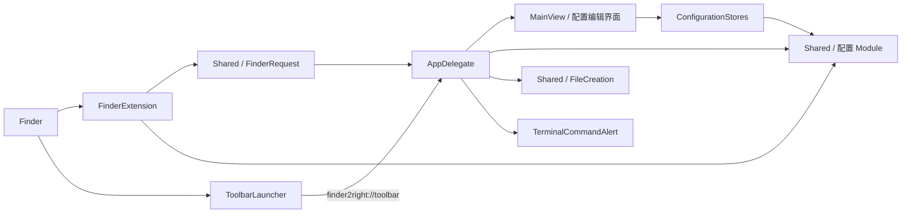

# Finder2right 架构

## 进程与依赖

ToolbarLauncher 是嵌入主 App 的辅助 App，由构建脚本单独编译。它只负责定位宿主并打开工具栏链接。FinderExtension 负责 Finder 菜单和请求发送。主 App 负责交互与实际执行。Shared 源码在需要它的 target 中编译，不是独立运行进程。

## 模块边界

| 模块 | 调用约束 | 源码（相对 Finder2right/） |
| --- | --- | --- |
| FinderRequest | action、directory 与 URL 双向转换；格式解析成功不代表目录有效或配置仍启用 | Shared/FinderRequest.swift |
| FileCreation | directory(from:) 检查目录，create(at:) 创建文件并保护已有文件 | Shared/FileCreation.swift |
| FileTypes / TerminalCommands / LauncherSettings | load、validated、save；缺失配置提供默认值，损坏配置抛错；写入采用原子替换 | Shared/ 中的对应文件 |
| FileTypeStore / TerminalCommandStore | 发布配置与错误，apply 成功落盘后更新内存 | App/ConfigurationStores.swift |
| TerminalCommandAlert | confirmation(command:directory:) 返回配置好的 NSAlert；调用方决定何时展示、如何处理确认结果 | App/TerminalCommandAlert.swift |
| AppDelegate | 系统生命周期与 URL 事件入口；负责窗口、请求完成与退出时机 | App/AppDelegate.swift |

## 设计约束

- 三类配置的默认值和校验规则不同，分别维护具体实现。
- Finder 会复制菜单且不保留 representedObject，扩展使用 tag 查表；主 App 使用 representedObject 携带请求，因此各自渲染菜单。
- TerminalCommandAlert 集中管理布局、可访问性、命令预览和快捷键；AppDelegate 展示弹窗并在确认后执行菜单命令。启动器的自定义命令行为直接执行。
- Finder 目录读取、Terminal 执行和请求生命周期集中在 AppDelegate；调整时需保留目录校验、AppleScript 错误信息，以及启动、重入、取消和异步完成的时序。

## 验证入口

- bash script/test.sh：Shared 行为、配置保存失败保护、菜单请求、确认弹窗和启动器拖拽。
- bash script/build_and_run.sh --build：构建主 App、Finder 扩展与内嵌启动器。

测试不执行真实用户终端命令，也不替代 Finder 扩展安装、自动化授权与实际点击验证。
