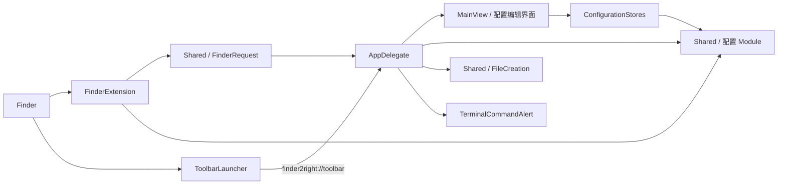

# Finder2right 架构

## 进程与依赖

ToolbarLauncher 是嵌入主 App 的辅助 App，由构建脚本单独编译。它只负责定位宿主并打开工具栏链接。FinderExtension 负责 Finder 菜单和请求发送。主 App 负责交互与实际执行。Shared 源码在需要它的 target 中编译，不是独立运行进程。

## Module 与 Interface

| Module | Interface / 调用方需要知道的规则 | Implementation 所在位置 |
| --- | --- | --- |
| FinderRequest | action、directory 与 URL 双向转换；格式解析成功不代表目录有效或配置仍启用 | Shared/FinderRequest.swift |
| FileCreation | directory(from:) 检查目录，create(at:) 创建文件并保护已有文件 | Shared/FileCreation.swift |
| FileTypes / TerminalCommands / LauncherSettings | load、validated、save；缺失配置提供默认值，损坏配置抛错；写入采用原子替换 | Shared 中的对应文件 |
| FileTypeStore / TerminalCommandStore | 发布配置与错误，apply 成功落盘后更新内存 | App/ConfigurationStores.swift |
| TerminalCommandAlert | confirmation(command:directory:) 返回配置好的 NSAlert；调用方决定何时展示、如何处理确认结果 | App/TerminalCommandAlert.swift |
| AppDelegate | 系统生命周期与 URL 事件入口；负责窗口、请求完成与退出时机 | App/AppDelegate.swift |

## 本次架构调整

把命令确认弹窗的创建与自定义布局收拢到 TerminalCommandAlert。原先 AppDelegate 的 Interface 为测试暴露了弹窗构建方法，Implementation 又依赖另一个同文件类型处理布局；现在调用方和测试跨越同一个 seam，只传入命令与目录即可获得完整弹窗。命令执行仍在 AppDelegate 中，确认取消时不执行的顺序保持原样。

这增加了弹窗 Module 的 Depth：布局、可访问性、完整命令预览、滚动高度和快捷键都隐藏在一个 Interface 后面。后续修改弹窗时，Locality 集中在一个文件，不需要修改生命周期调度。

## 保留的设计与后续优先级

1. 保留 Shared 中具体的配置 Module。三个配置的默认值与校验规则不同；当前重复的 JSON 读写很短，暂不引入泛型仓储或协议层。
2. 保留 FinderExtension 与主 App 各自的菜单渲染。Finder 会复制菜单且不保留 representedObject，扩展使用 tag 查表；主 App 使用 representedObject 携带请求。两种 Adapter 的约束不同，强行合并会扩大 Interface。
3. 下一处值得深化的是 Finder 目录读取与 Terminal 执行。它们目前位于 AppDelegate，依赖系统自动化权限；若需要独立测试或新增执行方式，再根据真实变化设计 seam。拆分时必须一起保留目录校验、AppleScript 错误信息与异步完成语义。
4. 请求生命周期状态仍集中在 AppDelegate。若继续增加入口，应先为启动、重入、取消和异步完成建立行为测试，再改变状态管理，避免仅拆文件却让完成时序散落到多个 Module。

## 验证入口

- bash script/test.sh：Shared 行为、配置保存失败保护、菜单请求、确认弹窗和启动器拖拽。
- bash script/build_and_run.sh --build：构建主 App、Finder 扩展与内嵌启动器。

测试不执行真实用户终端命令，也不替代 Finder 扩展安装、自动化授权与实际点击验证。
